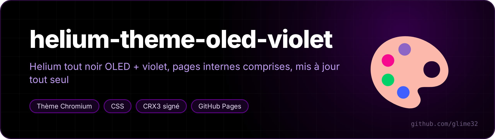
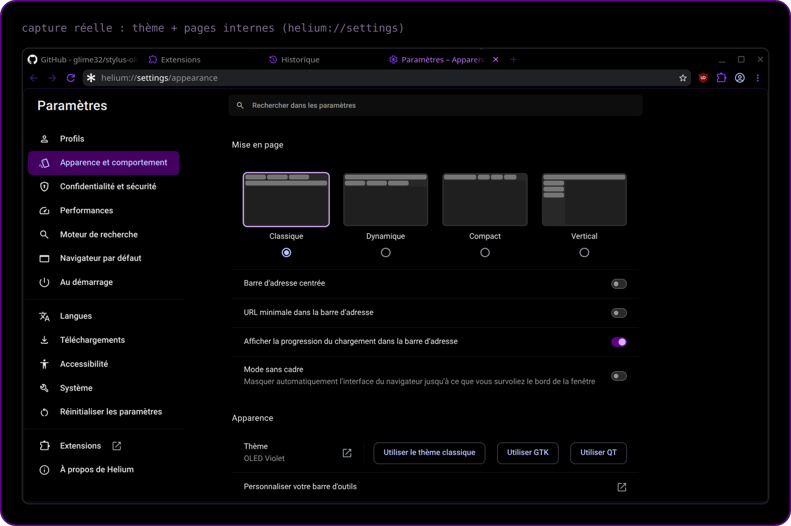
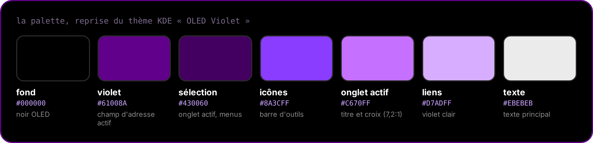

<p align="center"></p>

<p align="center"> </p>

<p align="center"><a href="README.md">🇬🇧 English version</a></p>

Noir OLED + violet `#61008A`, repris du thème KDE « OLED Violet ».

| Dossier | Extension | ID |
|---|---|---|
| `theme/` | **OLED Violet** — thème du navigateur (barres, onglets, champ d'adresse) | `ijefijobeglhilaepdlidhoccidilkjj` |
| `pages/` | **OLED Violet – pages internes** — `helium://settings`, extensions, historique, téléchargements, flags… | `gedllacmkafonphbnjkaebplipiiaogi` |

<p align="center"></p>

<p align="center"></p>

## Mise à jour automatique

Chaque push sur `main` lance l'action **Publier** : elle signe les deux extensions,
écrit `updates.xml` et publie sur <https://glime32.github.io/helium-theme-oled-violet/>.
Helium lit `update_url` dans les manifestes et installe la nouvelle version tout seul
(quelques heures max, ou tout de suite avec « Mettre à jour » dans `helium://extensions`,
mode développeur activé).

Pour changer une couleur : modifier `theme/manifest.json` ou `pages/oled.css`, puis push.

## Installation (une fois)

Le glisser-déposer d'un `.crx` est refusé (`CRX_REQUIRED_PROOF_MISSING`) : Helium exige
la signature du Web Store pour ce chemin. On passe par le lien direct à la place.

1. Dans `helium://flags`, activer puis relancer Helium :
   - `#extension-mime-request-handling` → **Always prompt for install**
   - `#extensions-on-chrome-urls` → **Enabled** (nécessaire pour `pages/`)
2. Ouvrir dans Helium :
   - <https://glime32.github.io/helium-theme-oled-violet/oled-violet-theme.crx> (le thème s'applique directement)
   - <https://glime32.github.io/helium-theme-oled-violet/oled-violet-pages.crx> → **Ajouter l'extension**

Limite connue : le champ d'adresse n'est violet que quand on clique dedans. Au repos,
Helium calcule sa couleur à partir de celle de la barre (noire → gris), un thème ne peut pas la forcer.

## Clés

Les clés de signature (`keys/*.pem`) fixent l'ID des extensions. Elles sont dans les
secrets du dépôt (`THEME_KEY`, `PAGES_KEY`) et en local dans `keys/` (ignoré par git).
Les perdre = nouvel ID = réinstaller à la main.

## Construire en local

```sh
pip install cryptography
python scripts/build.py 1.0.0 https://glime32.github.io/helium-theme-oled-violet   # → dist/
```
