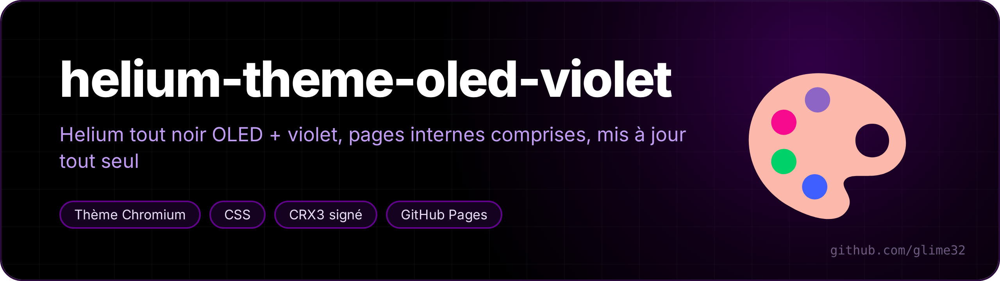
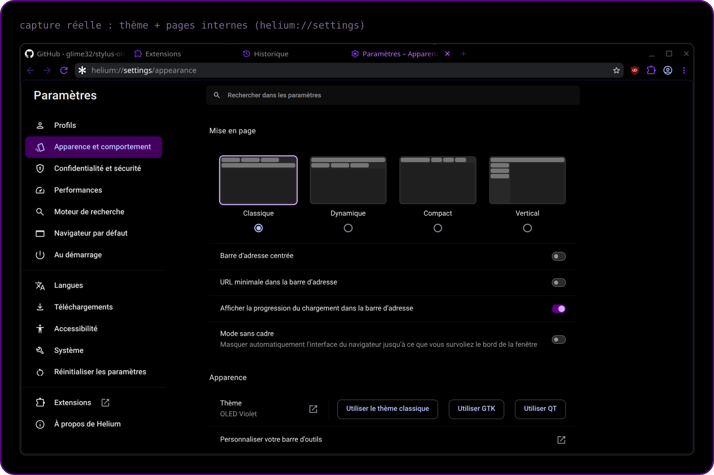
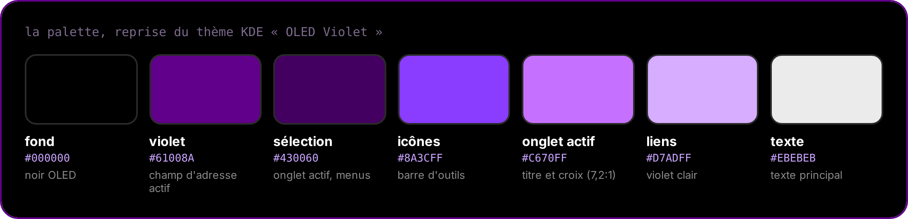

 

<a href="README.fr.md">🇫🇷 Version française</a>

**OLED black + purple `#61008A` for the [Helium](https://github.com/imputnet/helium) browser, internal pages included, taken from my KDE color scheme "OLED Violet". Updates itself.**

| Folder | Extension | ID |
|---|---|---|
| `theme/` | **OLED Violet**: browser theme (toolbar, tabs, address bar) | `ijefijobeglhilaepdlidhoccidilkjj` |
| `pages/` | **OLED Violet – pages internes**: `helium://settings`, extensions, history, downloads, flags… | `gedllacmkafonphbnjkaebplipiiaogi` |

## Auto-update

Every push to `main` runs the **Publier** action: it signs both extensions (CRX3), writes `updates.xml` and publishes them to <https://glime32.github.io/helium-theme-oled-violet/>. Helium reads `update_url` from the manifests and installs the new version by itself.

To change a color: edit `theme/manifest.json` or `pages/oled.css`, then push.

## Install (once)

Dragging a `.crx` in is refused (`CRX_REQUIRED_PROOF_MISSING`: Helium wants a Web Store signature for that path), so use the direct link instead.

1. In `helium://flags`, enable then restart Helium:
   - `#extension-mime-request-handling` → **Always prompt for install**
   - `#extensions-on-chrome-urls` → **Enabled** (needed for `pages/`)
2. Open in Helium:
   - <https://glime32.github.io/helium-theme-oled-violet/oled-violet-theme.crx> (the theme applies right away)
   - <https://glime32.github.io/helium-theme-oled-violet/oled-violet-pages.crx> → **Add extension**

Known limit: the address bar is only purple while you click in it. At rest, Helium derives its color from the toolbar color (black → gray); a theme can't force it.

## Keys

The signing keys (`keys/*.pem`) pin the extension IDs. They live in the repo secrets (`THEME_KEY`, `PAGES_KEY`) and locally in `keys/` (git-ignored). Losing them means new IDs and a manual reinstall.
